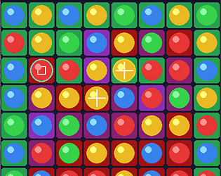

# Match 3 — Full Powerup Edition

A Match-3 puzzle game written in Python and Pygame. Swap gems, build powerups, fuse them into bigger blasts, and clear every tile layer on the board to win.

**Project page:** https://cloudbv.github.io/match_3_circle_classic/



## Run it

You need Python 3 and Pygame.

```bash
pip install pygame
python3 match3.py
```

The window is 512 × 592 pixels. Your best score is saved to `match3_highscore.json` next to the script.

## How to play

1. Click a gem to select it (yellow ring).
2. Click an adjacent gem to swap. If the swap makes no match, the gems slide back.
3. Match 3 or more gems of the same color in a row or column to clear them.
4. Every cleared gem removes one layer from the tile under it. Only the center 6×6 tiles have layers.
5. **Win** by clearing every layer in the center 6×6 area.

The game ends with **NO MORE MOVES** if no valid swap is left.

## Powerups

Created automatically from special matches. The powerup appears on the gem you just swapped.

| Powerup | Made by | Ring | Effect |
|---|---|---|---|
| Line Bomb | Match exactly 4 | Gold, cross symbol | Clears a full row or column, whichever damages more tiles |
| Color Bomb | Match 5 or more | Pink, dot pentagon | Clears every gem of its color on the board |
| Area Bomb | Match in an L or T shape | Teal, square symbol | Clears the 3×3 area around it |

Powerup gems never count as part of a normal match.

**Firing a powerup:**

- Double-click it to fire immediately.
- Swap it with a normal gem to fire it.
- Swap it with another powerup to fuse them.

## Fusions

Swap one powerup onto another. The order doesn't matter.

| Combo | Result | Effect |
|---|---|---|
| Line + Line | Cross Bomb | Full row and full column of both powerups |
| Line + Area | Mega Area | 5×5 blast |
| Area + Area | Mega Area | 5×5 blast |
| Line + Color | Color Line | All gems of that color plus their entire rows and columns |
| Area + Color | Color Area | All gems of that color plus a 3×3 around each |
| Color + Color | Wipe Board | Clears the entire board |

## Level and difficulty

Both are set on the start screen.

- **Difficulty (1–10):** the number of gem colors in play. More colors means harder matching.
- **Level (1–50):** the number of layers on each center tile. Level 1 needs one hit per tile, level 50 needs fifty. After a win, the Next Level button goes up by one.

## Scoring

| Component | Points |
|---|---|
| Base | 10 per gem cleared |
| Size bonus | +10 per gem beyond the first 3 |
| Chain bonus | +30 per chain level above 1 |

## Controls

| Input | Action |
|---|---|
| Click gem, click neighbor | Swap |
| Double-click a powerup | Fire it |
| HINT button | Highlight one valid swap |
| Shuffle button | Reshuffle the board (3 per game) |
| `ESC` | Back to menu at any time |
| `R` / `Q` | Menu / quit, from the win or game over screen |

## Files

| File | Purpose |
|---|---|
| `match3.py` | The whole game |
| `index.html` | Project page (served by GitHub Pages) |
| `screenshot.png` | Screenshot used on the page and in this README |
